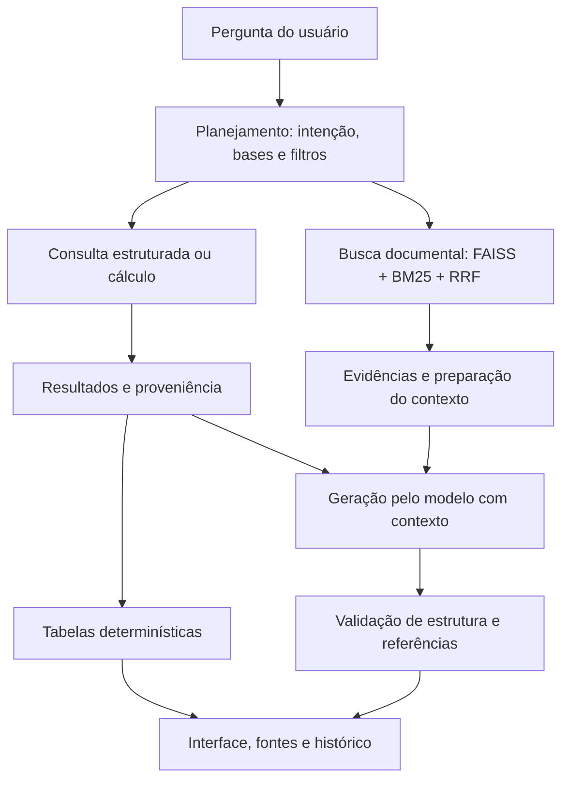

# Adaptive RAG para Contratações Públicas do RJ

**Grupo 1 · Cenário 1 · Grande Desafio de IA Generativa & RAG**

Residência TIC em Trilhas — PUC-Rio · Instituto ECOA

**Período:** 14/09/2026 a 23/10/2026
**Demo Day:** 23/10/2026

Consultas em linguagem natural que combinam cálculos sobre arquivos completos, recuperação documental e respostas com referências às fontes utilizadas.

[Materiais da entrega no Drive](https://drive.google.com/drive/folders/110gk1Q77490T6PJ_pYYsYL3L8iZ9xvsM?usp=sharing)

## Equipe

- Calvin Vinicius Costa da Silva
- Eridalgo Ramos da Silva
- Felipe Teixeira da Silva
- Janice Lira dos Santos
- Luiz Carlos Gomes da Silva Júnior
- Maria Eduarda Ribeiro da Silva

O desenvolvimento envolveu organização e avaliação do corpus, ingestão e metadados, recuperação, planejamento, geração, testes, observabilidade, interface e documentação.

## Cenário escolhido

**Cenário 1 — Contratações Públicas do Estado do Rio de Janeiro.**

Informações de contratação aparecem em registros do PNCP, planilhas, atas e legislação. Uma pergunta pode exigir contar registros, somar valores, identificar uma empresa ou explicar uma regra.

O objetivo foi reduzir a busca manual e permitir que o usuário confira os resultados nas fontes, apoiando equipes de compras, pesquisadores e profissionais de controle.

A aplicação consulta o corpus carregado. Ela não realiza uma consulta em tempo real a todo o PNCP e não cobre todas as contratações públicas.

## Dados utilizados

O pacote reúne **8 arquivos brutos e 2.172 chunks indexados**, distribuídos em quatro naturezas.

| Base | Conteúdo | Tratamento | Chunks |
| --- | --- | --- | ---: |
| Estruturada | 1.358 registros de contratações do PNCP no recorte associado ao RJ e à publicação em março de 2026 | Filtros, contagem e listagem na base normalizada | 1.358 |
| Normativa | Snapshot HTML da Lei nº 14.133/2021 | Recuperação de dispositivos e explicação com citações | 217 |
| Conversacional/documental | Três atas em PDF e uma comunicação sintética identificada como simulação | Recuperação textual e controles de dados pessoais | 78 |
| Agregada | PCA disponibilizado para o RJ em 2026 e itens do PE 038/26/2026 | Cálculos nos CSVs completos | 519 |
| **Total** | **JSON, CSV, PDF, HTML e TXT** | | **2.172** |

As atas foram organizadas na base conversacional/documental do projeto. A comunicação sintética é um material de teste, não um registro real.

### Recortes importantes

- **PNCP:** publicação entre 01/03/2026 e 31/03/2026, associada ao RJ. Ano da compra e ano da publicação são campos diferentes.
- **PCA:** 36.994 linhas. Ano e UF estão associados à origem do arquivo; não são filtros independentes por linha.
- **PE 038/26/2026:** 19 itens no arquivo de resultados.
- Os 519 chunks agregados não representam todas as linhas dos CSVs. Os cálculos suportados consultam os arquivos completos.
- Planejamento, homologação, entrega e pagamento representam situações diferentes.

Consulte o [manifesto do corpus](corpus_manifest.yaml) e a [arquitetura](ARQUITETURA.md).

## Arquitetura e funcionamento

O Adaptive RAG identifica qual tipo de evidência é necessário para responder à pergunta e seleciona o caminho correspondente.



O diagrama resume os caminhos funcionais. Na integração atual, o fluxo anterior pode executar etapas antes do despacho analítico, acrescentando trabalho e latência.

### Recuperação documental e geração

A busca vetorial encontra similaridade semântica, o BM25 contribui com correspondências lexicais e o RRF combina os rankings. Filtros e escopo ajudam a selecionar evidências pertinentes.

**A geração está implementada:** a pergunta e os trechos selecionados são enviados como contexto ao modelo, que produz a resposta com referências aos IDs fornecidos. A síntese explicativa é o padrão; existe também um modo extrativo para pedidos explícitos de apresentação de trechos.

A validação verifica estrutura e pertencimento das referências. Isso não garante automaticamente o suporte semântico de toda afirmação.

O controle **“Evidências para consultas documentais”**, de 1 a 5, tem padrão 3. Ele não determina três respostas ou três parágrafos e não limita os registros utilizados nos cálculos. A preparação do contexto pode reduzir o material efetivamente enviado.

### Consultas estruturadas e analíticas

A base normalizada do PNCP possui executor próprio para filtros, contagem e listagem.

O catálogo analítico utiliza os CSVs autorizados do PE 038/26/2026 e do PCA. O modelo interpreta o pedido e propõe um plano; o código valida campos e operações e executa os cálculos.

As operações incluem contagens, valores distintos, soma, média aritmética, mínimo, máximo, agrupamento, listagem, ordenação e comparações validadas. Os cálculos utilizam `Decimal`.

Resultados escalares ou mistos podem ser enviados ao gerador como contexto calculado. Quando todos os resultados são tabulares, o código pode apresentá-los diretamente, sem uma nova chamada de geração.

O evento `geracao` distingue a apresentação determinística em seus detalhes. Sua presença, sozinha, não comprova chamada ao modelo.

### Consultas combinadas

Pedidos reconhecidos com partes numéricas e documentais são separados. O resultado calculado e a explicação documental mantêm suas fontes e identificadores.

Um resultado calculado não é utilizado como evidência de uma regra jurídica.

### Rerank

O rerank local por cross-encoder foi implementado e avaliado, mas permaneceu **opcional e desativado na apresentação**.

A comparação registrada encontrou ganhos e perdas, sem melhoria consistente da cobertura das respostas no pequeno recorte avaliado.

- [Comparação de rankings](docs/comparacao_recuperacao_2026-10-19/RELATORIO.md)
- [Avaliação de respostas por método](docs/avaliacao_respostas_recuperacao_2026-10-19/RELATORIO.md)

Esses experimentos reutilizaram rankings preservados e não representam uma taxa geral de acerto do pipeline atual.

## Entregas concluídas

| Frente | Resultado |
| --- | --- |
| Corpus | Quatro bases organizadas, manifesto, hashes e pacote de dados |
| Preparação | Extração, chunks, metadados, embeddings e índices persistidos |
| Adaptive RAG | Planejamento e seleção de caminhos estruturados, analíticos, documentais ou combinados |
| Recuperação | Busca vetorial, BM25, RRF, escopo e preparação do contexto |
| Geração | Síntese com contexto e referências; modo extrativo disponível |
| Cálculos | Operações sobre arquivos completos, com filtros e proveniência |
| Interface | Consultas, plano, fontes, evidências e paginação quando aplicável |
| Persistência | Histórico SQLite e feedback JSONL vinculados às execuções |
| Observabilidade | Logs de consultas com etapas, identificadores, latência e tokens informados pelo serviço |
| Validação | Testes locais, compatibilidade dos artefatos e integração real |

O projeto foi apresentado no Demo Day de 23/10/2026. A entrega demonstra estratégias diferentes para necessidades diferentes, com resultados e fontes inspecionáveis.

O atendimento ao enunciado foi parcial em pontos de engenharia, detalhados nas limitações. A conclusão do período não significa ausência de pendências técnicas.

## Materiais da entrega

**[Abrir a pasta final do Grupo 1 no Google Drive](https://drive.google.com/drive/folders/110gk1Q77490T6PJ_pYYsYL3L8iZ9xvsM?usp=sharing)**

| Local | Conteúdo |
| --- | --- |
| `LEIA_PRIMEIRO.md` | Identificação e orientação geral |
| `apresentacao/` | Apresentação utilizada pela equipe |
| `dados_e_indices/data/` | Dados brutos, bases processadas, índices e cache |
| `execucao/` | Dependências e orientações |
| `documentacao/` | Cópias da documentação e evidências selecionadas |
| `MANIFESTO_SHA256.json` | Hashes e tamanhos dos arquivos registrados na organização da pasta |

O código-fonte e seu histórico permanecem neste repositório. O repositório é privado e os acessos ao GitHub e ao Drive precisam estar autorizados.

Backups de desenvolvimento, credenciais, histórico de consultas e feedback não integram a pasta final. Cópias documentais no Drive podem anteceder atualizações posteriores no GitHub.

O manifesto deve ser atualizado quando novos arquivos forem adicionados à pasta.

## Como executar

### 1. Obter o código

Clone com uma credencial autorizada, sem colocar tokens na URL:

```bash
git clone https://github.com/rag-grande-desafio-grupo1-cenario-1/repositorio1.git
cd repositorio1
```

**Código de referência da apresentação:** `086bbc66acbdf7264047cad28ef926f42020d6ab`.

Para reproduzir especificamente essa implementação:

```bash
git checkout 086bbc66acbdf7264047cad28ef926f42020d6ab
```

Atualizações documentais posteriores não representam nova validação do código. A tag `entrega-2026-10-19` preserva uma versão anterior.

### 2. Instalar as dependências

No computador local, crie um ambiente virtual:

```bash
python -m venv .venv
```

Ative com `source .venv/bin/activate` no Linux/macOS ou `.venv\Scripts\activate` no Prompt de Comando do Windows. No Colab, utilize o ambiente da sessão.

```bash
python -m pip install -r requirements.txt
```

Ambiente observado na preparação final: Python 3.13.16, OpenAI 2.54.0, FAISS CPU 1.15.1, NumPy 2.1.3, Pydantic 2.14.1, Gradio 6.30.0 e NLTK 3.9.1.

O `requirements.txt` usa majoritariamente versões mínimas e não é um lockfile. O inicializador depende dos templates internos do Gradio; a execução final foi conferida com Gradio 6.30.0.

### 3. Restaurar os dados do Drive

No Colab, monte o Drive e entre na raiz do repositório:

```python
from google.colab import drive
import os

if not os.path.ismount("/content/drive"):
    drive.mount("/content/drive")

os.chdir("/content/repositorio1")
```

O procedimento abaixo utiliza o manifesto da pasta final. No computador local, ajuste o caminho `PACOTE`.

```python
from pathlib import Path
import hashlib
import json
import shutil

REPO = Path.cwd().resolve()
PACOTE = Path(
    "/content/drive/MyDrive/rag_grande_desafio/ENTREGA_FINAL_GRUPO_1"
).resolve()

assert (REPO / "app/app.py").is_file(), "Execute da raiz do repositório."

manifesto = json.loads(
    (PACOTE / "MANIFESTO_SHA256.json").read_text(encoding="utf-8")
)

def sha256(caminho):
    resumo = hashlib.sha256()
    with caminho.open("rb") as arquivo:
        for bloco in iter(lambda: arquivo.read(1024 * 1024), b""):
            resumo.update(bloco)
    return resumo.hexdigest()

pares = []
for nome, registro in manifesto.items():
    if not nome.startswith("dados_e_indices/data/"):
        continue
    relativo = Path(nome[len("dados_e_indices/"):])
    assert not relativo.is_absolute() and ".." not in relativo.parts

    origem = (PACOTE / nome).resolve()
    destino = (REPO / relativo).resolve()

    assert origem.is_relative_to(PACOTE)
    assert destino.is_relative_to(REPO)
    assert origem.is_file(), nome
    assert sha256(origem) == registro["sha256"], nome

    if destino.exists():
        assert destino.is_file() and sha256(destino) == registro["sha256"], (
            f"Preserve o destino diferente antes de continuar: {relativo}"
        )

    pares.append((origem, destino, registro["sha256"]))

essenciais = {
    "data/processed/chunks_teste.json",
    "data/processed/base_estruturada_normalizada.json",
    "data/indices/faiss_index.bin",
    "data/indices/bm25_index.pkl",
    "data/indices/chunk_ids.json",
    "data/raw/v3/agregada/itens_pe_038_26_2026.csv",
    "data/raw/v3/agregada/pca_2026_estado_rj.csv",
}
presentes = {d.relative_to(REPO).as_posix() for _, d, _ in pares}
assert essenciais <= presentes, "Manifesto incompleto."

for origem, destino, esperado in pares:
    destino.parent.mkdir(parents=True, exist_ok=True)
    if not destino.exists():
        shutil.copy2(origem, destino)
    assert sha256(destino) == esperado

assert sha256(REPO / "data/processed/chunks_teste.json") == (
    "dcdcc7a0f8e34da1d0824b5322b6e37306c34e2d53d107c1ca067bc2771c8404"
)
print("Dados restaurados e conferidos:", len(pares))
```

Confirme o carregamento após verificar a origem dos arquivos:

```python
from src.retrieve import carregar_artefatos
from src.structured_query import carregar_base

chunks, por_id, ids, indice, bm25 = carregar_artefatos()
assert len(chunks) == len(por_id) == len(ids) == len(set(ids)) == 2172
assert indice.ntotal == 2172 and indice.d == 1024
assert bm25.corpus_size == 2172
assert len(carregar_base()) == 1358
print("Corpus, índices e base estruturada disponíveis.")
```

Não execute ingestão ou indexação apenas para iniciar a aplicação. Os embeddings do corpus e os índices já estão preparados.

Se aparecer `Base normalizada ausente`, confira `data/processed/base_estruturada_normalizada.json`. Restaurar somente chunks, índices e CSVs não é suficiente.

### 4. Configurar a sessão

Execute antes de importar a interface. No Colab, utilize caminhos persistentes fora da pasta final compartilhada:

```python
from datetime import datetime, timezone
from pathlib import Path
import os
import sys

instante = datetime.now(timezone.utc).strftime("%Y%m%dT%H%M%S%fZ")

if "google.colab" in sys.modules:
    assert os.path.ismount("/content/drive")
    base = Path(
        "/content/drive/MyDrive/rag_grande_desafio/execucoes_locais"
    )
else:
    base = Path.home() / "rag_grupo1_execucoes"

sessao = base / instante
sessao.mkdir(parents=True, exist_ok=False)

os.environ.update({
    "PIPELINE_LOG_DIR": str(sessao / "logs"),
    "HISTORY_PATH": str(base / "historico.sqlite3"),
    "FEEDBACK_PATH": str(base / "feedback.jsonl"),
    "GRADIO_SERVER_PORT": "7860",
    "RAG_ANALYTICAL_ENABLED": "true",
    "RAG_DEMO_OFFLINE": "false",
    "RERANK_ENABLED": "false",
    "LLM_REASONING_EFFORT": "none",
    "ROUTER_MAX_TOKENS": "512",
    "NORMATIVE_CONTEXT_MAX_CHARS": "6000",
    "DOCUMENT_CONTEXT_MAX_CHARS": "2500",
})
```

Os orçamentos de contexto são medidos em caracteres. A porta 7860 precisa estar disponível; ajuste se houver outra aplicação utilizando-a.

### 5. Conferir o serviço do modelo

A execução utiliza o serviço compatível com OpenAI disponibilizado pela residência:

- Geração: `qcwind/qwen3-8b-instruct-Q4-K-M`, listado também com `:latest`.
- Embeddings: `xagi/qwen3-embedding:0.6b-q4_k_m`.

A restauração evita recalcular embeddings do corpus, mas a busca vetorial ainda gera o embedding de cada nova pergunta.

**Configuração parcialmente centralizada:** `llm_ecoa.py` lê ambiente e `.env`, mas módulos do pipeline ainda mantêm constantes de endpoint e modelos. Alterar somente o `.env` não troca necessariamente o serviço em todo o pipeline. Confira `src/router.py`, `src/generate.py` e `src/retrieve.py` para outra instalação. Trocar o modelo de embeddings exige compatibilidade com os índices ou uma nova indexação identificada.

Verificação sem geração de resposta:

```python
from openai import OpenAI
from src import router

with OpenAI(
    base_url=router.OLLAMA_URL,
    api_key="ollama",
    timeout=20,
    max_retries=0,
) as cliente:
    modelos = {item.id for item in cliente.models.list().data}

def sem_latest(nome):
    return nome[:-7] if nome.endswith(":latest") else nome

assert sem_latest(router.GENERATION_MODEL) in {
    sem_latest(nome) for nome in modelos
}
assert "xagi/qwen3-embedding:0.6b-q4_k_m" in modelos
print("Serviço acessível e modelos listados.")
```

Não versione credenciais. Listar modelos confirma disponibilidade anunciada, mas não substitui uma consulta real.

### 6. Iniciar a interface

Na mesma sessão Python configurada anteriormente:

```python
import subprocess
import sys

subprocess.run(
    [sys.executable, "-u", "scripts/iniciar_interface_colab.py"],
    cwd=REPO,
    check=True,
)
```

O inicializador configura a pasta de logs e o frontend local e publica o link do Gradio. A célula permanece ocupada enquanto esse processo estiver ativo; isso é esperado.

Com as variáveis exportadas em um terminal, o comando equivalente é:

```bash
python scripts/iniciar_interface_colab.py
```

O link é temporário e depende do processo, da sessão e da rede. O histórico é compartilhado entre as pessoas que acessam essa instância.

### 7. Conferência mínima

1. Pergunte: **“No PE 038/26/2026, quantos itens foram homologados?”** Resultado de referência: **8 itens**.
2. Execute uma consulta documental e confira o texto e os trechos citados.
3. Limpe a tela e reabra uma consulta pelo histórico. A pergunta e a resposta original devem reaparecer sem nova geração.
4. Confira os logs pelo identificador da execução.

Encerrar o Colab pode remover o código e os dados que estejam somente em `/content`. Mantenha os materiais permanentes no Drive.

## Exemplos e resultados de referência

| Pergunta | Resultado observado |
| --- | --- |
| Quantos itens foram homologados, fracassados e desertos no PE 038/26/2026 e qual a soma homologada? | 8 homologados, 9 fracassados, 2 desertos e R$ 141.002,08; as situações somam 19 itens |
| Quais itens foram homologados no PE 038/26/2026? | Itens 1, 3, 4, 5, 7, 8, 11 e 14 |
| Quais fornecedores tiveram itens homologados no PE 038/26/2026? | ANDES COMERCIAL LTDA; GIGANTE PRODUTOS MEDICOS EIRELI; HOSPLIFE COMÉRCIO DE EQUIPAMENTOS HOSPITALARES LTDA EPP |
| Qual o objeto da ata nº 191/2026 da EBSERH e o PNCP correspondente? | Registro de preços para eventual aquisição de peças mamógrafas (chassis) para o CH-UFRJ/EBSERH; PNCP 15126437000305-1-000676/2026 |
| O que a Lei nº 14.133/2021 estabelece sobre o pregão? | Definição, aplicação e exceções, com referências aos dispositivos recuperados |
| Qual o valor total estimado médio por item do PCA disponibilizado para o RJ em 2026? | Aproximadamente R$ 1.512.908,15 no arquivo fornecido |
| Quais categorias aparecem nesse PCA? | Material e Serviço |
| Quantos itens foram homologados antes da assinatura do contrato no PE 038/26/2026? | Esclarecimento: a data de assinatura não está disponível no arquivo de itens |

Cada consulta é independente. Informe o processo, documento ou recorte necessário. O histórico não funciona como memória conversacional entre perguntas.

Os exemplos registram casos exercitados, sem garantir resposta idêntica em futuras execuções.

## Validação

### Última rodada completa registrada antes da apresentação

| Verificação | Resultado | Evidência |
| --- | --- | --- |
| Testes locais | **803 aprovados**, em 14,91 s | [Saída dos testes](docs/validacao_reformulacoes_2026-10-22/testes_locais.txt) |
| Integração real | **7 aprovados**, em 49,94 s, em execução separada | [Saída da integração](docs/validacao_reformulacoes_2026-10-22/integracao_real.txt) |
| Configuração e casos | Registros da rodada | [Evidências](docs/validacao_reformulacoes_2026-10-22/evidencias.json) |
| Artefatos | Corpus e índices conferidos sem regeneração | Manifesto do pacote e verificações de restauração |

As execuções ocorreram na árvore de trabalho que originou as correções integradas à implementação da apresentação. Não foram repetidas por causa desta revisão documental.

Existem rodadas anteriores com 754 testes locais e 7 de integração, além de reprodução histórica com 585 locais, 2 de compatibilidade e 7 de integração. Não some resultados de rodadas diferentes.

Alguns relatórios preservam estados anteriores à publicação. Isso não significa uma nova execução na data deste README.

### Observações na interface em 23/10/2026

Foram conferidas consultas sobre contagem, fornecedores, ata, legislação e reabertura pelo histórico. Também foram observadas limitações:

- Pergunta sem contratação definida recebeu resposta inadequada, confundindo marcas com fornecedores.
- Uma execução apresentou valores sem formatação monetária completa e sem total geral explícito.
- A preparação inicial deixou de restaurar a base estruturada normalizada, posteriormente localizada no pacote para restauração.

Essas observações mostram que testes aprovados, IDs válidos e cálculos corretos não garantem interpretação e suporte semântico em qualquer pergunta.

### Executar os testes

O `pytest.ini` exclui os testes marcados `llm` por padrão.

```bash
# Testes locais, com dados e índices restaurados.
python -m pytest -q -o addopts= -m "not llm" --ignore=testes/teste_integracao.py

# Integração com chamadas ao serviço real.
python -m pytest -v -o addopts= -m llm testes/teste_integracao.py
```

Os testes cobrem os contratos e casos exercitados, não todas as reformulações possíveis.

## Observabilidade, histórico e feedback

- **Logs:** JSONL com `run_id`, `query_id`, etapa, status, latência, entradas, saídas e tokens informados pelo serviço.
- **Histórico:** SQLite com a pergunta e o resultado original. Reabrir não executa novamente o pipeline.
- **Feedback:** JSONL vinculado à execução, separado do histórico. O registro não implica retreinamento automático.
- **Consultas combinadas:** podem referenciar uma execução documental própria por `documental_run_id` e `documental_query_id`.

Os tokens registrados não constituem uma estimativa completa de custo financeiro. Evite compartilhar bancos e registros de desenvolvimento na pasta de entrega.

## Limitações e próximos passos

| Limitação ou requisito parcial | Próximo passo |
| --- | --- |
| Corpus restrito ao snapshot e catálogo autorizado | Ampliar fontes e operações com validação por recorte |
| Perguntas ambíguas podem receber resposta inadequada | Melhorar detecção de falta de contexto e pedido de esclarecimento |
| Confusão entre marcas e fornecedores em consultas documentais | Reforçar avaliação de entidades e suporte das afirmações |
| Citação reconhecida não garante sustentação semântica | Ampliar avaliação de pertinência, completude e evidência |
| Formatação variável de valores, rótulos e totais | Padronizar a apresentação |
| Metadados de vigência e sensibilidade a revisar | Alinhar contratos e ampliar testes |
| Automação de coleta e logs de preparação parciais | Completar idempotência, limites de taxa, falhas por fonte e instrumentação |
| Configuração de serviço não centralizada | Unificar endpoint e modelos em todos os módulos |
| Dependência da disponibilidade do modelo | Melhorar tratamento de falhas e latência |
| Reprodução no mesmo Colab não equivale a validação em qualquer ambiente | Registrar reprodução independente por outro integrante |

Existem controles de mascaramento e recusa, mas isso não comprova proteção completa de todo dado pessoal possível.

A aplicação apoia consulta e conferência. Não substitui investigação, análise jurídica ou prova de execução contratual. Homologação e registro de preços não comprovam entrega ou pagamento.

## Estrutura do repositório

| Caminho | Finalidade |
| --- | --- |
| `app/` | Interface, adaptação dos caminhos, histórico e feedback |
| `src/` | Coleta, preparação, planejamento, execução, recuperação e geração |
| `scripts/iniciar_interface_colab.py` | Inicializador com frontend local |
| `testes/` | Testes e fixtures |
| `docs/` | Guias, relatórios e evidências |
| `eval/` | Avaliações e experimentos históricos |
| `acompanhamento/` | Registros individuais |
| `data/raw/` | Dados brutos restaurados |
| `data/processed/` | Chunks e base normalizada |
| `data/indices/` | Índices, IDs e cache de embeddings |

Reconstrução do corpus por coleta, ingestão ou indexação é diferente da restauração e deve gerar uma nova versão identificada.

## Documentação complementar

- [Arquitetura](ARQUITETURA.md)
- [Manifesto do corpus](corpus_manifest.yaml)
- [Correções de respostas — 21/10](docs/CORRECOES_RESPOSTAS_2026-10-21.md)
- [Correções de reformulações — 22/10](docs/CORRECOES_REFORMULACOES_2026-10-22.md)
- [Evidências da última rodada registrada](docs/validacao_reformulacoes_2026-10-22/evidencias.json)
- [Estado e evolução do projeto](docs/STATUS_DO_PROJETO.md)
- [Guia histórico de restauração](docs/GUIA_RESTAURACAO_2172.md)
- [Reprodução histórica](docs/reproducao_d31d05a_2026-10-19/RELATORIO.md)
- [Comparação dos métodos de recuperação](docs/comparacao_recuperacao_2026-10-19/RELATORIO.md)
- [Avaliação de respostas por método](docs/avaliacao_respostas_recuperacao_2026-10-19/RELATORIO.md)

O guia histórico usa um manifesto de formato diferente. Para a pasta final, siga as instruções deste README.

**Fechamento documental: 23/10/2026.** Relatórios históricos preservam suas versões e condições. Esta atualização documental não altera código, corpus ou índices e não representa nova execução dos testes.
